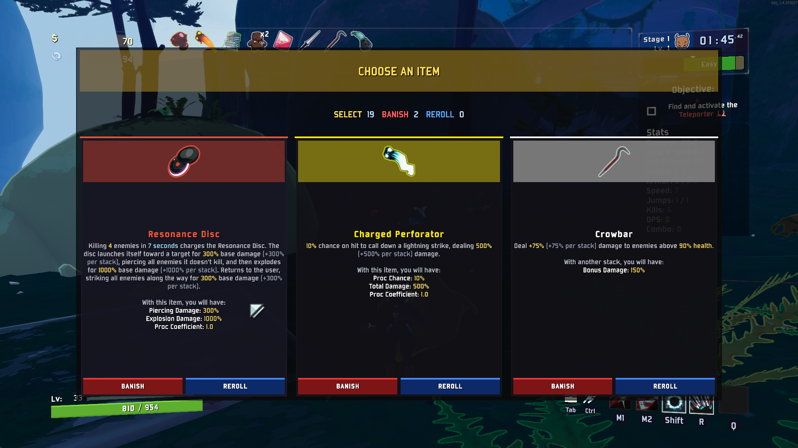

# LevelUpChoices

This mod removes most of the normal item sources from stages, like chests and printers. You get to pick your items when your team levels up.

Turn on the Artifact of Choice when you start a run, or use **Always Enable Mod** in Risk of Options.

Normal barrels, combat shrines, and Scavenger's Sacks still spawn. You can change most of the settings in Risk of Options.

For bugs or suggestions, contact me on Discord (@erenkara).

## How it works

Press **F3** to open the menu when you have a pick saved up. You get up to 3 choices by default.

**Reroll** swaps out a choice, and **Banish** keeps it out of your picks for the rest of the run. By default, you start with 1 of each token and get another banish every 10 levels. Picking gives you your reroll token back.

Sometimes you'll roll an item that's similar to one you already have. This makes it easier to stack items or find ones that go well together.

## Equipment rounds

Your 10th round gives you equipment choices. After that, they have a 12% chance of showing up, with at least one item round in between. If you want an item that round, hit **Choose Item Instead**.

The host can change the chance or turn equipment rounds off. Equipment barrels and shops are removed if you have both equipment rounds and interactable removal on.

## Levels and XP

The default max level is 256. You can change it in the settings.

## Mod Support

Items from other mods can show up in the picker too. LookingGlass adds more detail to the cards.

The host can use **Item Blacklist** in Risk of Options to block items from the picker and the Artifact of Equality. The list kicks in on the next run.

If you think a certain mod item should be disabled or enabled, please open an issue on GitHub.

## Multiplayer

You still get your own picks and tokens in multiplayer. Everyone needs the same version of the mod as the host.

## Credits

Thanks to [max-arias/level-up-fixes](https://github.com/max-arias/level-up-fixes) for ideas behind the blacklist and interactable changes.
