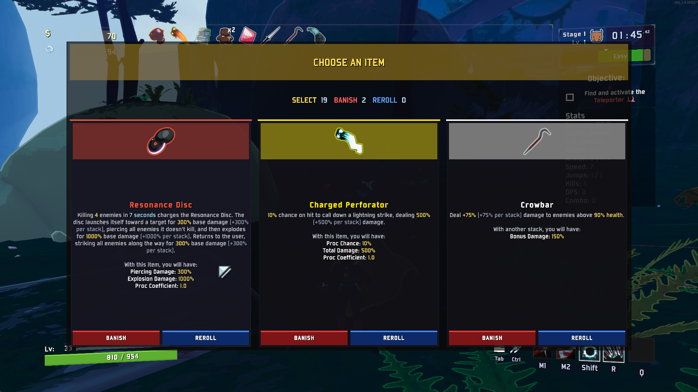
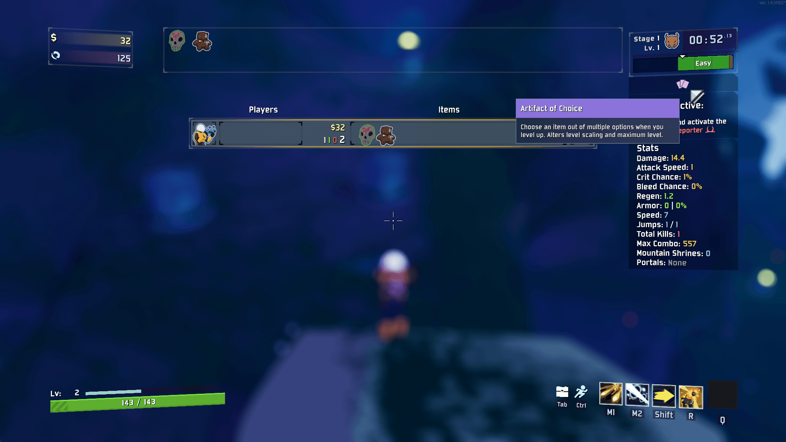
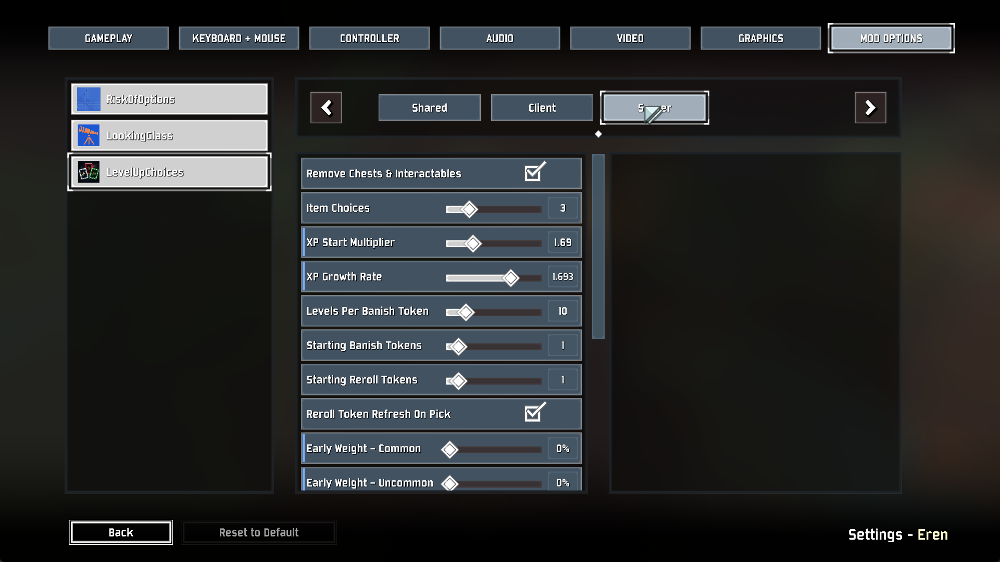

# LevelUpChoices

This mod removes most of the normal item sources from stages, like chests and printers. You get to pick your items when your team levels up.

Turn on the Artifact of Choice when you start a run, or use **Always Enable Mod** in Risk of Options.

Normal barrels, combat shrines, and Scavenger's Sacks still spawn. You can change most of the settings in Risk of Options.

For bugs or suggestions, contact me on Discord (@erenkara).

## How it works

Press **F3** to open the menu when you have a pick saved up. You get up to 3 choices by default.

**Reroll** swaps out a choice, and **Banish** keeps it out of your picks for the rest of the run. By default, you start with 1 of each token and get another banish every 10 levels. Picking gives you your reroll token back.

Sometimes you'll roll an item that's similar to one you already have. This makes it easier to stack items or find ones that go well together.

## Equipment rounds

Your 10th round gives you equipment choices. After that, they have a 12% chance of showing up, with at least one item round in between. If you want an item that round, hit **Choose Item Instead**.

The host can change the chance or turn equipment rounds off. Equipment barrels and shops are removed if you have both equipment rounds and interactable removal on.

## Levels and XP

The default max level is 256. You can change it in the settings.

## Mod Support

Items from other mods can show up in the picker too. LookingGlass adds more detail to the cards.

The host can use **Item Blacklist** in Risk of Options to block items from the picker and the Artifact of Equality. The list kicks in on the next run.

If you think a certain mod item should be disabled or enabled, please open an issue on GitHub.

## Multiplayer

You still get your own picks and tokens in multiplayer. Everyone needs the same version of the mod as the host.

## Credits

Thanks to [max-arias/level-up-fixes](https://github.com/max-arias/level-up-fixes) for ideas behind the blacklist and interactable changes.

## Changelog

### 1.2.0

- Added equipment rounds. You get equipment choices on round 10 by default. After that, there's a 12% chance of seeing them again, with at least one item round in between. You can change the chance in the settings or hit **Choose Item Instead** to pick an item that round.
- Added a searchable item blacklist in Risk of Options. The host can block items from the picker and the Artifact of Equality. Changes apply on the next run.
- Combat shrines are back. Interactable removal now catches more loot sources, including lockboxes and Shipping Request Form deliveries. The picker also skips the keys and forms when those sources are disabled.
- Equipment barrels and shops are removed when equipment rounds and interactable removal are both on.
- Slightly lowered how many interactables can spawn. The host can change that in the settings, and it takes effect on the next stage.
- Red items are a bit rarer early on, and it takes a little more XP to level up at the start.
- Rerolls and banishes now skip anything already on screen. If there's nothing left to roll, you keep your token.
- F3 works while you're moving, and item icons no longer flash white between picks.
- LookingGlass now shows more info on equipment cards.

Previous versions

## 1.1.5

- Fixed item picker and ESC menu conflicts. The picker should be hidden whenever the actual game menu is open and come back when you close it, respecting your pause settings.
- Item rolls now use their own random seed based on the run seed, so they won't affect the game's other loot rolls.
- Improved performance by reducing unnecessary recalculations when generating item options.

## 1.1.4

- Updated game references and dependencies for Risk of Rain 2 1.5, including the Hallowed Concepts update.
- Updated LookingGlass and Risk of Options integration libraries.
- Updated item cards to load addressable item icons while retaining support for modded sprite icons.

## 1.1.3

- Added a new artifact called "Artifact of Equality". When enabled, monsters will get a new item every time they level up. After all, we're all equal in death.
- Previously monster level scaling was taking place but it wasn't showing in the game UI. Now it correctly shows the real value.
- Added config syncing from host to clients.

## 1.1.2

- Refactored UI and some parts of the codebase.
- Added an artifact for the mod. Now you need to choose the artifact in-game to enable the mod. Or you can use the "Always Enable" config to use it like before.
- Added luck calculation. Your positive or negative luck determines how many rolls each item slot will get and depending on the luck value, it will pick the best or worst items for you.
- Added item similarity and synergy system. Items that are similar and synergistic to the items you own will have a higher chance of appearing in the item selection UI. Chances are configurable.
- Added dotnet tooling and refactored some code.
- Added max level configuration. Now instead of increasing the XP scaling, we increase the max level thus making each level easier or harder depending on the new max level.

## 1.1.1

- Fixed a bug where clients on a multiplayer game would not get any item rolls.

## 1.1.0

- Fixed a bug where some items weren't being disabled even though "remove interractables" option is set.

## 1.0.9

- Removed all types of "Scrap"s from the drop table, unless the player is using the Drifter character.
- Disabled items that are unobtainable. Previously if you didn't have a DLC, you still saw the item in the item selection UI but when you clicked it, you would lose your token and not get any items. This is automatically detected when a player joins.
- Fixed a bug where you would only get 1 experience if you set the exp multiplier configuration high and you were at 80+ levels.
- Removed "Artifact Key" from the drop table.
- Removed "Chance Doll", "Executive Card", "Sale Star", "Hallowed Ichor", "Sequenced Fate", "Universal VIP Pass", "Primal Birthright" from the drop table when interactable removal is enabled.

## 1.0.8

- Added a way to pause the game when item selection UI is displayed. Works in both singleplayer and multiplayer but when creating a multiplayer game, the host must enable multiplayer pause.

## 1.0.7

- Fixed a bug where you didn't get correct amoutn of item selection tokens when levelling up multiple times.
- Added support for LookingGlass. It's not a required dependency but when installed alongside this mod, it will enhance the descriptions of items.
- Improved item selection UI.

## 1.0.6

- Added configuration and RiskOfOptions support. Available configurations;
1. Shared: Toggling mod to completely disable it.
2. Client: Changing settings such as shortcut key for the item selection UI, UI scale etc...
3. Server: Toggling disabling of interactables, the number of item options serverd to players when they level up, the rates for the items etc...

## 1.0.5

- Updated README

## 1.0.4

- Updated experience scaling logic. It's a bit harder than the previous logic after level 30 but still not as bad as the game's original logic.
- Updated drop table logic. Now seeing Tier 3's shouldn't be too common in early game. Additionally memory and CPU usage is optimized for the host.
- Added new icon
- Added back normal barrels to reduce the spawn rate of equipment barrels.
- Updated design of the item select menu.
- Split code for readability.

## 1.0.3

- Fixed a bug with Banish/Reroll buttons overlapping.
- Released the code on GitHub

## 1.0.2

- You can now select the entire item card to select that, instead of just being able to select an item by clicking its image.
- Fixed user being able to open item select UI without having a select token or being in the lobby.
- Fixed cursor/camera lock bug after selecting an item.
- Added demo image to README

## 1.0.1

- Updated README

## 1.0.0

- First release

